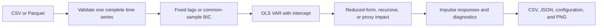

# Vector autoregression

Use this skill for a VAR and its impulse responses. The skill uses `vars::VAR` with OLS and an intercept. It does not fit panel VARs, VECMs, Bayesian VARs, or local projections.

Read [the configuration reference](references/configuration.md) before you prepare a run. Read [the methods reference](references/methods.md) when you select identification, normalization, or inference.

## Prepare the run

1. Confirm the time column, frequency, variables, input units, and sample with the user's request.
2. Preserve the supplied variable units and transformations.
3. Select reduced-form, recursive, or proxy identification from the request.
4. Use an explicit variable order for recursive identification.
5. Set `normalization_variable` and `impact_target` together when the request specifies an impact size. Set `normalization_shock` if another shock needs that impact scale.
6. For proxy identification, specify one instrument and the proxy residualization method.
7. Write a YAML configuration from [an example](examples/reduced_form.yml).



The default method is `reduced_form`. The default lag rule is BIC over lags 1 through 12, subject to sample size. The default horizons are 0 through 10. The default seed is `20261102`.

Do not describe a reduced-form response as a structural causal effect. Recursive identification requires the stated order assumptions. Proxy identification requires a relevant, valid instrument. The first-stage diagnostics do not prove instrument validity.

## Run the estimator

Use R 4.6.1. Run setup explicitly on a new machine. Setup restores the versions in `renv.lock` to the external R library cache. The estimator never installs packages or starts a download.

```powershell
Rscript --vanilla <skill-root>/scripts/setup.R
Rscript --vanilla <skill-root>/scripts/run_var.R <config.yml>
Rscript --vanilla <skill-root>/tests/test_var.R
python <skill-root>/scripts/install.py
python <skill-root>/scripts/install.py --verify
```

Replace `<skill-root>` with the absolute skill directory. Replace `<config.yml>` with the configuration path. The installer copies the bundle to the personal skills directories for Cursor, Claude, Agents, and Codex. Its `--verify` option checks every installed file against the source bundle. The configuration resolves file paths relative to its own directory. Use a new output directory outside the skill bundle for each retained analysis.

For points only, set `inference.bootstrap_draws: 0`. For reduced-form and recursive inference, the default is 1,999 residual bootstrap draws with 95% pointwise percentile intervals. The bootstrap fixes the selected lag count. It centers residuals, preserves initial observations, and refits the model and impact matrix for every draw. A failed draw stops the run with its draw number.

Proxy VAR supports point estimates only. Reject requests for proxy confidence intervals. Do not substitute ordinary residual bootstrap intervals for proxy inference.

## Inspect the result

Check sample dates, selected lags, residual degrees of freedom, design rank, and companion eigenvalues. Check the reported impact matrix against the requested normalization. For proxy VAR, check the separate instrument sample and first-stage diagnostics. Keep the full VAR sample distinct from the available proxy sample.

The estimator rejects duplicate periods, gaps, incomplete VAR variables, panel identifiers, and unidentified normalization. An unstable model can return point estimates with a warning. The estimator refuses the stationary residual bootstrap for an unstable model.

The output directory contains the following files.

- `estimates.csv` contains response, shock, horizon, method, estimate, lower, and upper.
- `results.json` contains estimates, diagnostics, resolved configuration, input hash, package versions, and source hashes.
- `config_used.yml` records the resolved run settings.
- `impulse_responses.png` shows the responses at 300 dpi.
- `lag_selection.csv` contains common-sample AIC and BIC when the run selects lags.
- `residuals.csv` records the full VAR residual sample.
- `covariance_ml.csv` and `covariance_df_adjusted.csv` record both covariance conventions.
- `impact.csv` records the impact responses.
- `instrument_sample.csv` records the available instrument rows and residualized values for proxy VAR.

Report the chosen method, sample, lag rule, units, normalization, inference method, and important warnings with the result. Return the PNG and a link to `results.json`. Do not return a causal conclusion from these files alone.

If `Rscript` is absent from PATH, use its full executable path. Keep the `--vanilla` flag.

Run `python tests/test_install.py` from the skill directory to check the installer without changing personal folders.
