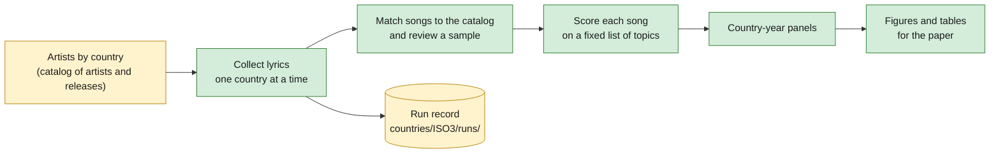
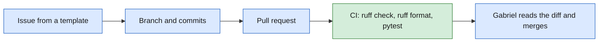

# research-songs

A research dataset of song lyrics by country, scored on topics, built for one economics paper. Code, tests, run records and documentation live here. Data and the paper do not: data stays in local and cloud storage, and no lyric text is ever committed.

> Work in progress. Nothing here is a finding until it appears in the paper.

## The question

What do popular songs talk about, how does that differ across countries, and how does it change as countries grow richer, more democratic and demographically different? The project measures the topics of songs from many countries over several decades and relates them to economic and social outcomes.

## How the data is built



Every collection run leaves a run record: what was collected, from which source, with which limits, and when. The records are how people and agents know what exists, so no job runs twice.

## How a change reaches main



`main` accepts only pull requests with passing checks. People and coding agents follow the same path and the same rules, which are in [`AGENTS.md`](AGENTS.md). Three agents can work on an issue: one plans, one builds, one reviews. A person starts each stage with a label, and a person merges. [`prompts/roles/`](prompts/roles/README.md) describes the flow.

## What exists

| Area | State |
| --- | --- |
| Repository rules, CI, templates | Working |
| Shared library (configuration, paths) | Working; storage helpers arrive with the code that needs them |
| Data layout (paths, table schemas, manifests) | Working: [data layout](docs/standards/data_layout.md). Old data is not converted yet |
| Country folders and run records | Working: `songs lyrics history`, and [coverage by country](docs/status/coverage.md) |
| Lyric collection and matching | Planned |
| Country-year panel | Working in part: `songs panel countries`. Democracy, populism, banking crises and the corpus counts wait for their inputs |
| Topic scoring | Planned |
| Figure and topic standards | Working: [figures](docs/standards/figures.md), [topics](docs/standards/topics.md) |
| Analysis and figure registry | Planned |
| Agent workflows on GitHub (planner, builder, reviewer) | Planned |

## Layout

```
src/songs/        importable, tested code
tests/            tests and small fixtures
docs/decisions/   why the project works the way it does
docs/status/      generated status pages
docs/standards/   figure, topic, data source and data layout standards
countries/        one folder per country (ISO3 code) with its run records
resources/        small tracked files that code reads, such as the list of data sources
exhibits/         figures and tables for the paper and the presentation
prompts/roles/    instructions for the planner, builder and reviewer agents
prompts/scoring/  the model configuration and prompt for topic scoring
.github/          CI, agent workflows, code owners, issue and pull request templates
AGENTS.md         rules for agents and people
CONTRIBUTING.md   how to make a change
```

Every external variable (income, democracy, fertility and others) has its source in [`docs/standards/data_sources.md`](docs/standards/data_sources.md).

Every data file has its place, and every table has its columns, in [`docs/standards/data_layout.md`](docs/standards/data_layout.md). Read it before you write code that reads or writes data.

## Setup

You need [uv](https://docs.astral.sh/uv/) and Git. uv installs Python 3.14 for you.

```bash
git clone https://github.com/gabrielsgaspar/research-songs.git
cd research-songs
uv sync --all-groups
uv run pytest
```

The tests need no data and no credentials. To work with real data, copy `.env.example` to `.env` and set `SONGS_DATA_ROOT` to your local data folder. Ask Gabriel which data you need. [`docs/standards/data_layout.md`](docs/standards/data_layout.md) describes the folders inside the data folder.

To make a change, read [`CONTRIBUTING.md`](CONTRIBUTING.md).

## License

MIT for code. Song lyrics belong to their owners and are not part of this repository. Other data keep the licenses of their sources.
